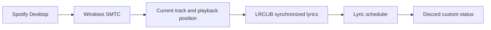

<div align="center">

# Discord Lyrics Spotify

**Synchronized Spotify lyrics in your Discord custom status.**

[](https://www.microsoft.com/windows)
[](https://nodejs.org/)


</div>

---

Discord Lyrics Spotify reads playback from the Spotify desktop app and displays the matching lyric line as your Discord custom status. It uses Windows media controls and LRCLIB, so it does not need a Spotify API key or Spotify Premium.

The app runs locally from the terminal; it does not build or use a standalone `.exe`.

## Quick start

### Install

Requirements: Windows 10 or 11, Node.js 18 or newer, and the Spotify desktop app.

```bash
git clone https://github.com/ryanmhildan/discord-lyrics-spotify.git
cd discord-lyrics-spotify
npm install
npm start
```

On first launch, the app opens a local setup page in your browser. Enter your Discord user token to validate and save it on your machine. Once setup finishes, play music in Spotify to start updating your status.

### Configure with an environment variable

If you prefer, create a `.env` file in the project root:

```env
DISCORD_USER_TOKEN=your_discord_user_token_here
```

The environment variable takes priority over the locally saved token.

> **Token safety:** A Discord user token grants access to your account. Treat it like a password. Do not publish or share it, and do not enter it into untrusted websites or tools. Using a user token for automation may violate Discord's Terms of Service and could put your account at risk.

## Usage

```bash
npm start
```

During development, restart automatically when source files change:

```bash
npm run dev
```

Clear the saved token and run setup again:

```bash
npm start -- --reset
```

If `DISCORD_USER_TOKEN` is set in `.env` or your environment, remove or unset it first; environment tokens take priority over the saved token. Stop the app with `Ctrl+C`.

## How it works

The app checks Spotify playback every second, fetches synchronized lyrics when a track changes, and schedules each line against the track's playback position.



- Seeks resynchronize the lyric scheduler.
- Pausing or stopping playback clears the custom status.
- If synchronized lyrics are unavailable, the app displays the track title and artist.
- Discord status updates are queued and retried when rate-limited.

## Project structure

| File | Purpose |
| --- | --- |
| `src/index.js` | Polling loop and application orchestration |
| `src/spotify.js` | Reads playback through Windows SMTC and PowerShell |
| `src/lyrics.js` | Fetches and parses synchronized lyrics from LRCLIB |
| `src/scheduler.js` | Schedules lyric lines by timestamp |
| `src/status.js` | Updates Discord status with queue and retry handling |
| `src/config.js` | Reads and stores the Discord user token |
| `src/setup.js` | Local browser setup page and token validation |

## Troubleshooting

### Spotify is not detected

- Use the Spotify desktop app, not the web player.
- Confirm that a track is playing.
- Make sure Windows media controls show the Spotify session.

### Lyrics are missing

LRCLIB may not have lyrics for the track or may only provide unsynchronized lyrics. In that case, the app displays the track title and artist instead.

### Discord status is not updated

- Confirm that the configured token is valid.
- Check that your network can reach Discord.
- If Discord rate-limits requests, wait for the app to retry.
- Run `npm start` from a terminal and check its output for errors.

To remove the saved configuration manually, delete:

```text
%APPDATA%\discord-lyrics-spotify\config.json
```

## License

The project declares the MIT license in [`package.json`](package.json).
